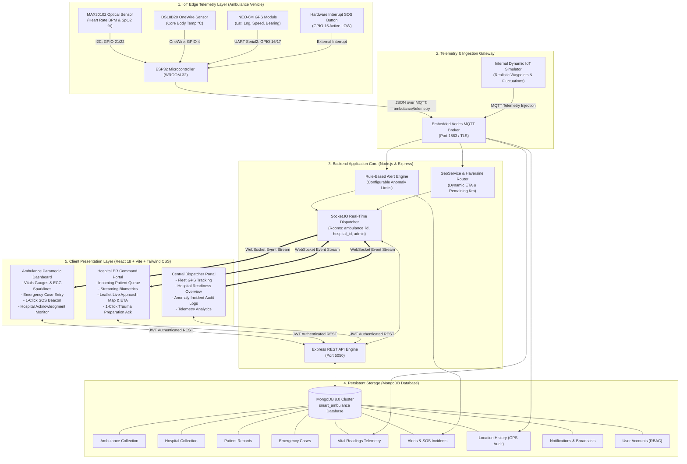

# System Architecture & Technical Specifications

**Project:** IoT-Based Smart Ambulance and Emergency Communication System  
**Platform Code Name:** SmartPulse IoT  

---

## 1. High-Level System Architecture Diagram



---

## 2. Component Design & Modularity

### A. IoT Edge & Microcontroller Subsystem
- **Decoupled Architecture:** The physical hardware connects to the backend exclusively using standard MQTT topics (`ambulance/telemetry`). The backend does not depend on physical hardware presence; if hardware is disconnected, the embedded simulation service generates equivalent payloads with identical schema keys, preventing frontend breakage.
- **Payload Schema:**
  ```json
  {
    "ambulanceId": "GJ-05-EM-1081",
    "patientId": "PAT-4011",
    "heartRate": 84,
    "spo2": 98,
    "temperature": 36.8,
    "latitude": 21.1730,
    "longitude": 72.8235,
    "speed": 48.0,
    "emergency": false,
    "hardware": true,
    "timestamp": 1774167000
  }
  ```

### B. Ingestion & Communication Layer
- **Aedes MQTT Broker:** Embedded directly into the Node.js application process, eliminating the operational overhead of installing Mosquitto or maintaining cloud broker credentials.
- **Socket.IO Real-Time Dispatcher:** Implements targeted pub/sub rooms (`ambulance_<id>`, `hospital_<id>`, `emergency_<id>`, `admin`) so hospital ER staff only receive biometrics for patients directed to their specific trauma unit.

### C. Backend Engine & Processing
- **Alert Engine:** Compares continuous biometrics against demonstration thresholds:
  - Tachycardia: Heart rate > 100 BPM (Critical: > 120 BPM)
  - Bradycardia: Heart rate < 60 BPM (Critical: < 45 BPM)
  - Hypoxemia: SpO2 < 94% (Critical: < 90%)
  - Hyperthermia / High Fever: Core temperature > 38.0°C (Critical: > 39.5°C)
  - Panic SOS: Hardware push button or manual software dispatch.
- **GeoService & Transit Calculator:** Implements the Haversine trigonometric formula to calculate distance between ambulance GPS coordinates and hospital destination, dynamically computing ETA with emergency vehicle transit adjustment factors.
