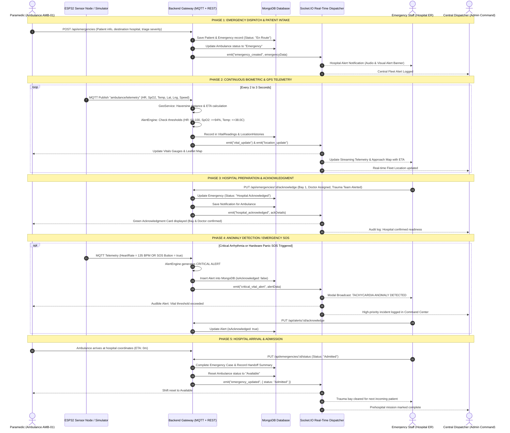

# Emergency Communication Data Flow & Sequence Diagram

---

## 1. Complete Prehospital Emergency Workflow Sequence Diagram

---

## 2. Real-Time Socket.IO Channels & Event Mapping

| Event Name | Direction | Payload Description | Target Recipients |
|---|---|---|---|
| `join_ambulance` | Client -> Server | Ambulance ID | Joins vehicle-specific private room |
| `join_hospital` | Client -> Server | Hospital ID | Joins trauma center private room |
| `join_emergency`| Client -> Server | Emergency Case ID | Joins active incident monitoring channel |
| `join_admin` | Client -> Server | `null` | Joins global dispatcher command room |
| `vital_update` | Server -> Client | Latest `{ heartRate, spo2, temperature, isAbnormal }` | Paramedic, receiving Hospital, Admin |
| `location_update` | Server -> Client | Latest `{ latitude, longitude, speed, distanceKm, etaMinutes }` | Paramedic, receiving Hospital, Admin |
| `new_emergency_alert` | Server -> Client | Emergency Case with patient details | Assigned Hospital ER portal |
| `hospital_acknowledged`| Server -> Client | Readiness checklist, assigned bay, ER physician | Ambulance paramedic dashboard |
| `critical_vital_alert` | Server -> Client | Threshold anomaly / SOS details | Hospital, Ambulance, Admin modal popups |
