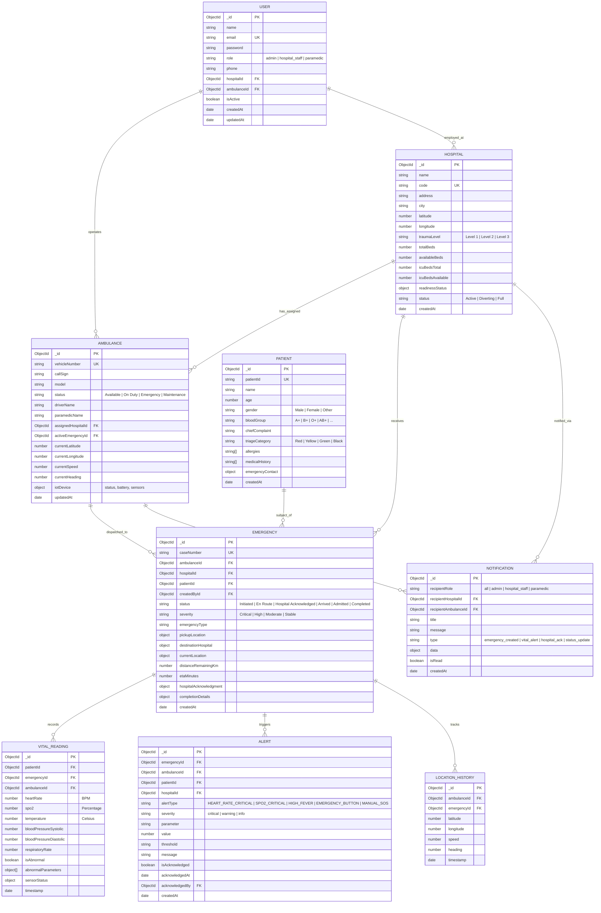

# Database Entity-Relationship (ER) Specifications

**Database Engine:** MongoDB 8.0 with Mongoose ODM  
**Database Name:** `smart_ambulance`  

---

## 1. Complete Mermaid ER Diagram

---

## 2. Key Collections, Indexes & Constraints

| Collection Name | Primary Index | Secondary Indexes | Validation & Integrity Rules |
|---|---|---|---|
| `users` | `_id` | `email` (Unique, Lowercase) | Passwords hashed using bcrypt (10 rounds), valid RFC email regex |
| `hospitals` | `_id` | `code` (Unique), Geo: `(latitude, longitude)` | Required trauma level and emergency hotline contacts |
| `ambulances` | `_id` | `vehicleNumber` (Unique), `status`, Geo: `(latitude, longitude)` | Status restricted to enumerated state machine |
| `patients` | `_id` | `patientId` (Unique), `triageCategory` | Age validated between 0 and 130, required chief complaints |
| `emergencies` | `_id` | `caseNumber` (Unique), `hospitalId`, `ambulanceId`, `status` | Automatic linkage to active vehicle and hospital |
| `vitalreadings`| `_id` | Compound: `(patientId, timestamp: -1)`, `(emergencyId, timestamp: -1)` | Heart rate (20-300), SpO2 (50-100), Temp (25-45) |
| `alerts` | `_id` | Compound: `(hospitalId, isAcknowledged, createdAt: -1)` | Automatic 15-second debounce against duplicate unacknowledged triggers |
| `locationhistories` | `_id` | Compound: `(ambulanceId, timestamp: -1)` | Historical coordinates tracking for route replay |
| `notifications` | `_id` | Compound: `(recipientRole, isRead, createdAt: -1)` | Targeted unread counters for hospital staff and paramedics |
